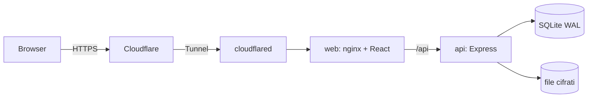

# EasySend

[English](README.md) | Italiano

EasySend è un'applicazione web self-hosted per inviare file di grandi dimensioni, simile a WeTransfer. La esegui sul tuo server, dietro un Cloudflare Tunnel, quindi non si apre nessuna porta in ingresso.


## Indice

1. [Panoramica](#1-panoramica)
2. [Architettura](#2-architettura)
3. [Requisiti](#3-requisiti)
4. [Preparazione del container LXC](#4-preparazione-del-container-lxc)
5. [Installazione](#5-installazione)
6. [Primo setup (wizard)](#6-primo-setup-wizard)
7. [Token API di Cloudflare](#7-token-api-di-cloudflare)
8. [Backup e ripristino](#8-backup-e-ripristino)
9. [Aggiornamento, deploy e rollback](#9-aggiornamento-deploy-e-rollback)
10. [Disinstallazione](#10-disinstallazione)
11. [Rotazione della chiave master](#11-rotazione-della-chiave-master)
12. [Note di sicurezza](#12-note-di-sicurezza)
13. [Dimensioni delle immagini e uso delle risorse](#13-dimensioni-delle-immagini-e-uso-delle-risorse)
14. [Sviluppo in locale](#14-sviluppo-in-locale)
15. [Test](#15-test)
16. [Risoluzione dei problemi](#16-risoluzione-dei-problemi)
17. [Licenza](#17-licenza)

## 1. Panoramica

- Upload ripristinabili di file molto grandi con il protocollo [tus](https://tus.io), a blocchi da 25 MB (il piano gratuito di Cloudflare rifiuta le richieste oltre 100 MB).
- I file sono cifrati sul disco del server (AES-256-GCM). Upload, download e zip sono in streaming, quindi la RAM non cresce con la dimensione del file.
- Condivisione con link o con email. Scadenza a 3 giorni, 1 settimana o 1 mese. Password e limite di download facoltativi. Un trasferimento si può revocare in qualsiasi momento.
- Il mittente riceve un avviso al primo download.
- Utenti con ruoli (admin, utente) e quote per utente. L'autenticazione a due fattori (TOTP) è obbligatoria per gli admin.
- Interfaccia in italiano e inglese, tema chiaro e scuro, branding configurabile (nome, loghi, colori, sfondo, footer).
- Wizard di setup: account admin, SMTP, tunnel Cloudflare e impostazioni generali. Nessun file di configurazione da modificare a mano.
- Nessuna anteprima dei file, nessun antivirus integrato, nessuna registrazione pubblica (vedi [Note di sicurezza](#12-note-di-sicurezza)).

| Pagina di download                                                     | Admin: utenti                                              |
| ---------------------------------------------------------------------- | ---------------------------------------------------------- |
|  |  |

Altri screenshot (chiari e scuri) sono in [docs/screenshots/](docs/screenshots/).

## 2. Architettura



| Container     | Contenuto                                                                   | Limite di memoria |
| ------------- | --------------------------------------------------------------------------- | ----------------- |
| `web`         | nginx che serve l'app React e inoltra `/api` all'api                        | 128 MB            |
| `api`         | Express, server di upload tus, database SQLite (WAL), archivio file cifrati | 768 MB            |
| `cloudflared` | Client del Cloudflare Tunnel (profilo `tunnel`)                             | 128 MB            |

I dati stanno in due volumi Docker: `easysend-data` (database, file cifrati, branding, segreti) e `easysend-shared` (il token del tunnel scritto dal wizard e letto da `cloudflared`).

## 3. Requisiti

- Un LXC Proxmox con Debian 12, Docker CE e il plugin Compose (vedi [Preparazione del container LXC](#4-preparazione-del-container-lxc)). Funziona anche qualsiasi host Linux con Docker.
- 2 GB di RAM per tutto lo stack. I limiti di memoria sopra sommano circa 1 GB.
- Spazio su disco: mentre un file viene cifrato esiste due volte (la copia caricata e quella cifrata), quindi prevedi almeno 2 volte la dimensione del file più grande che gestirai, più tutto ciò che conservi. L'app rifiuta un upload quando `spazio libero - riserva < 2 x dimensione`. La riserva predefinita è 1 GB e si cambia nelle impostazioni admin.
- Un dominio gestito da Cloudflare (basta il piano gratuito) e un token API ([sezione 7](#7-token-api-di-cloudflare)).
- Un server SMTP funzionante: le notifiche sono sempre attive, quindi il wizard richiede un'email di prova inviata con successo.

## 4. Preparazione del container LXC

Docker dentro un LXC non privilegiato richiede le funzioni `nesting` e `keyctl`.

Sull'host Proxmox scarica il template Debian 12 (`pveam update && pveam available | grep debian-12`, poi `pveam download local <template>`) e crea il container (adatta ID, nome del template, storage e bridge):

```sh
pct create 200 local:vztmpl/debian-12-standard_12.7-1_amd64.tar.zst \
  --hostname easysend --unprivileged 1 --features nesting=1,keyctl=1 \
  --cores 2 --memory 2048 --swap 512 \
  --rootfs local-lvm:40 --net0 name=eth0,bridge=vmbr0,ip=dhcp
pct start 200
```

Dall'interfaccia grafica: Create CT, lascia spuntato "Unprivileged container", poi seleziona il container, Options, Features, Edit e spunta Nesting e keyctl. Riavvia il container.

Dentro il container installa Docker CE dal repository ufficiale:

```sh
apt update && apt install -y ca-certificates curl sudo
install -m 0755 -d /etc/apt/keyrings
curl -fsSL https://download.docker.com/linux/debian/gpg -o /etc/apt/keyrings/docker.asc
chmod a+r /etc/apt/keyrings/docker.asc
echo "deb [arch=$(dpkg --print-architecture) signed-by=/etc/apt/keyrings/docker.asc] https://download.docker.com/linux/debian $(. /etc/os-release && echo $VERSION_CODENAME) stable" \
  > /etc/apt/sources.list.d/docker.list
apt update
apt install -y docker-ce docker-ce-cli containerd.io docker-compose-plugin
```

Crea un utente normale, aggiungilo al gruppo `docker` e imposta il fuso orario:

```sh
adduser easysend
usermod -aG docker easysend
timedatectl set-timezone Europe/Rome
```

Esci e rientra perché il gruppo venga applicato. I comandi seguenti si eseguono con quell'utente.

## 5. Installazione

Le immagini sono pubbliche su GHCR: `ghcr.io/ivanerricis/easysend-api`, `-web` e `-cloudflared`. Non serve fare login al registry. La versione in uso è fissata in `.env` come `APP_VERSION` (mai `latest`).

```sh
sudo mkdir -p /opt/easysend && sudo chown "$USER": /opt/easysend
cd /opt/easysend
V=0.1.0   # la release che vuoi
RAW=https://raw.githubusercontent.com/ivanerricis/easysend/v$V
mkdir -p scripts/lib
curl -fsSL -o docker-compose.yml $RAW/docker-compose.yml
curl -fsSL -o .env.example $RAW/.env.example
for f in deploy.sh rollback.sh backup.sh uninstall.sh lib/common.sh; do
  curl -fsSL -o scripts/$f $RAW/scripts/$f
done
chmod +x scripts/*.sh
cp .env.example .env
chmod 600 .env
./scripts/deploy.sh          # ultima release
# oppure: ./scripts/deploy.sh 0.1.0
```

`deploy.sh` scrive `APP_VERSION` in `.env`, scarica le immagini e avvia lo stack. Per fork o registry privati si imposta `IMAGE_PREFIX` in `.env` (predefinito `ghcr.io/ivanerricis/easysend`).

`.env.example` imposta già `COMPOSE_FILE=docker-compose.yml` e `COMPOSE_PROFILES=tunnel`. Tutto il resto, configurato nel wizard o nel pannello admin, è salvato nel database e non in `.env`.

## 6. Primo setup (wizard)

Il container web è pubblicato solo su `127.0.0.1:8080` dell'LXC, quindi prima di configurare Cloudflare lo raggiungi con un tunnel SSH. Dal tuo PC:

```sh
ssh -L 8080:127.0.0.1:8080 easysend@<indirizzo-lxc>
```

Apri http://localhost:8080. Il wizard chiede un codice di setup, che l'api stampa nel log a ogni avvio finché il setup non è completo:

```sh
cd /opt/easysend
docker compose logs api | grep "Setup code"
```

I passi:

1. **Account admin**: email e password, poi autenticazione a due fattori obbligatoria (scansiona il QR) e codici di recupero. Salva i codici: si vedono una sola volta.
2. **SMTP**: server, porta, credenziali e mittente. Il wizard invia un'email di prova e non ti lascia proseguire finché non riesce.
3. **Cloudflare**: il tuo dominio, l'hostname per l'app e un token API ([sezione 7](#7-token-api-di-cloudflare)).
4. **Impostazioni generali**: nome dell'istanza, riserva di spazio su disco, dimensione dei chunk di upload, lingua e tema predefiniti.

Quando il passo Cloudflare termina, il container `cloudflared` parte da solo e l'app risponde su `https://<il tuo hostname>`. Da lì puoi chiudere il tunnel SSH e usare l'indirizzo pubblico.

## 7. Token API di Cloudflare

Il wizard usa il token una sola volta per creare il tunnel e il record DNS. Non viene mai salvato né scritto nei log. Permessi minimi:

| Ambito  | Risorsa           | Permesso |
| ------- | ----------------- | -------- |
| Account | Cloudflare Tunnel | Edit     |
| Zone    | DNS               | Edit     |
| Zone    | Zone              | Read     |

Crealo dalla dashboard:

1. My Profile, API Tokens, Create Token, "Create Custom Token".
2. Aggiungi i tre permessi qui sopra.
3. Account Resources: includi solo il tuo account. Zone Resources: includi solo la zona (dominio) che userai.
4. Continue to summary, Create Token, copia il valore e incollalo nel wizard. Puoi revocarlo subito dopo il setup.

Cosa crea il wizard:

- un tunnel chiamato `easysend-<esadecimale casuale>`, riusato se ripeti il passo, con ingress verso `http://web:8080`;
- un CNAME con proxy per il tuo hostname, che punta al tunnel;
- il token del tunnel, scritto nel volume condiviso (`/shared/tunnel-token`, modo 600) e letto da `cloudflared`.

Se esiste già un record DNS con quel nome, il wizard si ferma senza creare nulla. Il TLS termina su Cloudflare, quindi nella dashboard (SSL/TLS) attiva "Always Use HTTPS" e abilita HSTS.

## 8. Backup e ripristino

Cosa conservare:

| Cosa                            | Dove                               |
| ------------------------------- | ---------------------------------- |
| Database                        | volume `easysend-data`             |
| File cifrati                    | volume `easysend-data`             |
| Loghi, favicon, sfondo          | volume `easysend-data`             |
| Chiave master, segreto sessioni | volume `easysend-data`, `secrets/` |
| Configurazione                  | `.env`, `docker-compose.yml`       |

Backup completo:

```sh
./scripts/backup.sh            # scrive in /opt/easysend/backups
./scripts/backup.sh /mnt/usb   # oppure in un'altra cartella
```

Crea un backup coerente del database tramite la CLI di backup dell'api (mai una copia del file in uso), poi scrive `easysend-backup-<ora UTC>.tar.gz` con modo 600, che contiene il backup del database, `storage/`, `branding/`, `secrets/`, `.env` e `docker-compose.yml`.

**L'archivio contiene la chiave master.** Chi ha l'archivio può decifrare tutti i file. Conservalo cifrato oppure offline, e copialo fuori dall'LXC. Senza la chiave master (`APP_SECRET_KEY` o `/data/secrets/app.key`) i file, i segreti TOTP e la password SMTP sono illeggibili, anche se il resto dei dati è intatto.

Ripristino su un'installazione pulita o rotta (stessa versione o più recente). Gli stessi passi li stampa `./scripts/backup.sh --help`.

```sh
# 1. ricrea la cartella di installazione con .env, docker-compose.yml e scripts/ della release
mkdir /opt/easysend && cd /opt/easysend
tar xzf <archivio> .env docker-compose.yml
chmod 600 .env
#    (scarica scripts/ dalla release come nella sezione 5)

# 2. crea i volumi vuoti
docker compose create

# 3. copia i dati nel volume (<progetto> è il nome del progetto Compose,
#    di solito il nome della cartella di installazione: vedi `docker volume ls`)
docker run --rm -i -v <progetto>_easysend-data:/data alpine:3.24.2 \
  sh -c 'tar xzf - -C /tmp data && cp -a /tmp/data/. /data/' < <archivio>

# 4. ripristina il database (nome del file con: tar tzf <archivio> | grep sqlite)
docker compose run --rm --no-deps api node dist/cli/restore-db.js manual-<timestamp>.sqlite

# 5. avvia
docker compose up -d
```

Ogni tanto prova un ripristino su una macchina di prova: un backup mai ripristinato è solo una speranza.

## 9. Aggiornamento, deploy e rollback

Le note di rilascio sono su [GitHub Releases](https://github.com/ivanerricis/easysend/releases). Per aggiornare:

```sh
cd /opt/easysend
./scripts/deploy.sh            # ultima release
./scripts/deploy.sh 0.2.0      # una versione precisa
```

Cosa fa `deploy.sh [versione] [--force] [--yes]`:

1. controlla Docker, Compose, curl e `.env`, e ricorda la versione attuale in `.deploy/`;
2. scarica e valida il `docker-compose.yml` del tag della release;
3. fa il backup del database (se lo stack è in esecuzione);
4. scarica le immagini, aggiorna `APP_VERSION`, esegue `docker compose up -d --wait`;
5. controlla `/health` e che riporti la nuova versione.

Se qualcosa fallisce dopo il passaggio, versione precedente, file compose e database vengono ripristinati in automatico. La cronologia è in `.deploy/history.log`.

Per tornare a mano alla versione precedente:

```sh
./scripts/rollback.sh              # ripristina anche il database salvato prima dell'ultimo deploy
./scripts/rollback.sh --keep-db    # tiene il database attuale
```

Ripristinare il database scarta tutto ciò che è stato scritto dopo quel deploy (il database attuale viene prima salvato come `app-pre-restore-<ora>.sqlite`). Con `--keep-db` i dati restano, ma una versione più vecchia potrebbe non capire un database già migrato da una più nuova. Le vecchie immagini restano su disco per rendere i rollback rapidi; libera lo spazio con `docker image prune -a` quando non ti servono più.

Nota: nelle versioni 0.x, le release che cambiano la minor possono contenere modifiche incompatibili. Leggi prima le note di rilascio.

## 10. Disinstallazione

```sh
./scripts/uninstall.sh            # rimuove container, rete e immagini; mantiene dati, .env e .deploy/
./scripts/uninstall.sh --purge    # cancella anche volumi, .env e .deploy/
```

Il comando predefinito è reversibile: `./scripts/deploy.sh <versione>` riporta tutto com'era. `--purge` propone prima un backup e chiede di digitare `easysend`. La cartella `backups/` viene mantenuta.

Cloudflare non viene toccato, perché il token non è mai salvato. Pulisci a mano:

1. Zero Trust, Networks, Tunnels: elimina il tunnel `easysend-...`.
2. Il tuo dominio, DNS: elimina il CNAME dell'hostname.
3. Revoca il token API se lo hai ancora (My Profile, API Tokens).

## 11. Rotazione della chiave master

Ruota la chiave master se sospetti che sia trapelata. Il comando ricifra le chiavi dei singoli file, i segreti TOTP e le impostazioni cifrate, dopo aver salvato un backup del database. L'api deve essere ferma.

```sh
cd /opt/easysend
./scripts/backup.sh        # prima, sempre
docker compose stop api && docker compose run --rm --no-deps api node dist/cli/rotate-key.js && docker compose up -d api
```

- **Chiave in un file** (il caso predefinito, `/data/secrets/app.key`): la nuova chiave lo sostituisce e la vecchia resta come `app.key.previous`.
- **Chiave in `APP_SECRET_KEY`**: la nuova chiave viene scritta in `/data/secrets/app.key.new`. Copiala in `APP_SECRET_KEY` nel file `.env` prima di riavviare l'api.

Il comando è idempotente. Se è stato interrotto, rilancialo con `--new-key-file <file>` che punta alla stessa nuova chiave. La chiave non viene mai stampata. I codici di recupero non dipendono dalla chiave master e restano validi.

## 12. Note di sicurezza

- **Cifratura a riposo**: ogni file è cifrato con AES-256-GCM a segmenti da 64 KiB. Ogni file ha una propria chiave casuale, protetta con una chiave derivata (HKDF) dalla chiave master.
- **File in chiaro durante l'upload**: il file caricato resta non cifrato nella cartella temporanea di tus (stesso volume, `/data/tmp`) finché la cifratura non termina, poi viene cancellato. È un compromesso accettato: la cifratura parte a upload completato, così gli upload interrotti si possono riprendere.
- **Nessun antivirus**: i file non vengono analizzati. Un'opzione futura è un sidecar ClamAV che analizza il file temporaneo prima della cifratura tramite un hook; non è implementato.
- **Log**: gli indirizzi IP compaiono solo come hash HMAC, mai in chiaro. I token di download non vengono registrati. I log dei container ruotano (3 file da 10 MB per servizio). I log di download e di audit si conservano 90 giorni.
- **Tieni `WEB_BIND` su `127.0.0.1`**. Se pubblichi la porta web sulla rete, i client possono falsificare `X-Forwarded-For` e `CF-Connecting-IP` e aggirare i limiti di richieste e l'hash degli IP.
- **HSTS**: abilitalo su Cloudflare, perché il TLS termina lì.
- **Prova SMTP**: un admin può far connettere il server a qualsiasi host e porta tramite la prova SMTP. È riservata agli admin e limitata (10 all'ora).
- Le password usano argon2id, le sessioni sono lato server con token salvati come hash, il CSRF è controllato su ogni richiesta non sicura e ogni input è validato con Zod.

Per segnalare una vulnerabilità vedi [SECURITY.md](SECURITY.md) (in inglese).

## 13. Dimensioni delle immagini e uso delle risorse

Misurato nella fase 6 (Alpine, build multi-stage, API in un unico bundle con tsdown):

| Immagine      | Dimensione | Prima  |
| ------------- | ---------- | ------ |
| `api`         | 241 MB     | 339 MB |
| `web`         | 31,9 MB    | 104 MB |
| `cloudflared` | 73 MB      |        |

| Caso                                            | Memoria                                                                                             |
| ----------------------------------------------- | --------------------------------------------------------------------------------------------------- |
| A riposo                                        | api circa 43 MiB, web circa 8 MiB                                                                   |
| File da 1 GB: upload, cifratura, download e zip | picco RSS di Node nell'api circa 156 MB, picco del container circa 482 MB (fase zip), limite 768 MB |

La memoria non dipende dalla dimensione del file, perché upload, cifratura, download e zip sono tutti in streaming. Per misurarla tu su uno stack locale: `node scripts/measure-transfer.mjs --size-gb 5`.

## 14. Sviluppo in locale

Prerequisiti: Node 26 (versione in `.nvmrc`; con [fnm](https://github.com/Schniz/fnm) basta `fnm use`), pnpm 12.14.0 (campo `packageManager`) e Docker Desktop avviato.

```sh
pnpm install
pnpm local:up
```

| Comando            | Cosa fa                                                        |
| ------------------ | -------------------------------------------------------------- |
| `pnpm local:up`    | costruisce e avvia lo stack in Docker (web, api, Mailpit)      |
| `pnpm local:down`  | lo ferma, mantenendo i dati                                    |
| `pnpm local:reset` | lo ferma e cancella i volumi locali                            |
| `pnpm dev`         | api (tsx watch) e Vite fuori da Docker, solo Mailpit in Docker |

Indirizzi:

- Stack Docker: http://localhost:8080 (app), http://localhost:8080/api/health, http://localhost:8025 (Mailpit).
- `pnpm dev`: http://localhost:5173 (Vite con ricaricamento automatico e proxy verso l'api sulla porta 3000). I dati vanno in `.local-data/`.

Mailpit raccoglie tutte le email, qualunque sia il destinatario. Se altri progetti usano le stesse porte, cambiale in `.env.local` (creato da `.env.local.example`): `LOCAL_WEB_PORT`, `MAILPIT_UI_PORT`, `MAILPIT_SMTP_PORT`, `DEV_API_PORT`, `DEV_WEB_PORT`.

Per saltare il wizard puoi creare un admin da riga di comando (solo in modalità locale; chiede la password due volte e il 2FA si configura al primo login):

```sh
pnpm user:create-admin -- --email tu@example.com
# nello stack Docker: docker compose -p easysend-local exec api node dist/cli/create-admin.js --email tu@example.com
```

Note:

- **Browser**: i cookie di sessione sono `Secure`. Chrome, Firefox e Edge li accettano su http://localhost, Safari no. Apri l'app solo da `localhost`, non dall'IP della rete locale.
- **Windows**: si consiglia WSL2 con il progetto nel filesystem Linux (per esempio `~/progetti`), per prestazioni dei volumi e permessi corretti.
- **Disco di Docker Desktop**: in locale lo spazio libero che vede l'app è quello del disco virtuale di Docker Desktop, non del tuo PC. Per ingrandirlo: Docker Desktop, Settings, Resources, Disk image size. Il file del disco virtuale (VHDX) non si riduce da solo quando liberi spazio.

## 15. Test

| Comando             | Cosa fa                                                                                                                                          |
| ------------------- | ------------------------------------------------------------------------------------------------------------------------------------------------ |
| `pnpm lint`         | ESLint su tutto il repository, zero warning                                                                                                      |
| `pnpm typecheck`    | `tsc --noEmit` in ogni pacchetto                                                                                                                 |
| `pnpm test`         | test unitari Vitest di tutti i pacchetti                                                                                                         |
| `pnpm test:mailpit` | avvia Mailpit da `docker/docker-compose.test.yml`, invia le email vere e le controlla tramite la sua API                                         |
| `pnpm test:e2e`     | Playwright su uno stack in modalità produzione con API Cloudflare finta e Mailpit (progetto `easysend-e2e`, http://localhost:18090)              |
| `pnpm screenshots`  | stack isolato, completa il wizard e un trasferimento, salva gli screenshot chiaro/scuro in `docs/screenshots/`, fallisce su violazioni axe serie |

`pnpm test:e2e` e `pnpm screenshots` usano Microsoft Edge installato sul PC. Imposta `PW_CHANNEL=chromium` per usare invece il Chromium incluso in Playwright, come fa la CI.

## 16. Risoluzione dei problemi

- **Codice di setup non trovato o scaduto**: `docker compose logs api | grep "Setup code"`. Riavviando l'api (`docker compose restart api`) ne viene stampato uno nuovo. Anche un tentativo con codice errato o scaduto ne genera uno nuovo.
- **Il wizard non si apre**: la porta web è legata a `127.0.0.1` dell'LXC. Usa il tunnel SSH della [sezione 6](#6-primo-setup-wizard).
- **Il login non resta attivo in locale**: Safari non accetta i cookie `Secure` su http. Usa Chrome, Firefox o Edge e apri `localhost`.
- **Il tunnel non si collega**: `docker compose logs cloudflared`. Controlla che il file del token esista (`docker compose exec api ls -l /shared`) e che il passo Cloudflare del wizard sia finito bene. Il container riavvia da solo il tunnel quando il file del token cambia.
- **"Spazio su disco insufficiente" in upload**: serve `libero - riserva >= 2 x dimensione` ([sezione 3](#3-requisiti)). Libera spazio, elimina vecchi trasferimenti o abbassa la riserva nelle impostazioni admin.
- **Porte già occupate (locale)**: cambiale in `.env.local` ([sezione 14](#14-sviluppo-in-locale)).
- **Le email non arrivano**: usa la prova SMTP nelle impostazioni admin e guarda `docker compose logs api`. In locale apri Mailpit su http://localhost:8025.
- **Un deploy è fallito ed è tornato indietro**: leggi `.deploy/history.log` e `docker compose logs api`, correggi la causa e rilancia il deploy.

## 17. Licenza

[MIT](LICENSE). I contributi sono benvenuti: vedi [CONTRIBUTING.md](CONTRIBUTING.md) (in inglese). Segnalazioni di sicurezza: [SECURITY.md](SECURITY.md).
