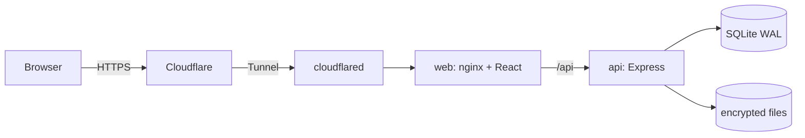

# EasySend

English | [Italiano](README.it.md)

EasySend is a self-hosted web application for sending large files, similar to WeTransfer. You run it on your own server, behind a Cloudflare Tunnel, so no inbound port is opened.


## Contents

1. [What it is](#1-what-it-is)
2. [Architecture](#2-architecture)
3. [Requirements](#3-requirements)
4. [LXC preparation](#4-lxc-preparation)
5. [Installation](#5-installation)
6. [First setup (wizard)](#6-first-setup-wizard)
7. [Cloudflare API token](#7-cloudflare-api-token)
8. [Backup and restore](#8-backup-and-restore)
9. [Updating, deploy and rollback](#9-updating-deploy-and-rollback)
10. [Uninstall](#10-uninstall)
11. [Master key rotation](#11-master-key-rotation)
12. [Security notes](#12-security-notes)
13. [Image sizes and resource usage](#13-image-sizes-and-resource-usage)
14. [Local development](#14-local-development)
15. [Tests](#15-tests)
16. [Troubleshooting](#16-troubleshooting)
17. [License](#17-license)

## 1. What it is

- Resumable uploads of very large files with the [tus](https://tus.io) protocol, in chunks of 25 MB (the Cloudflare free plan refuses requests above 100 MB).
- Files are encrypted on the server's disk (AES-256-GCM). Upload, download and zip are streamed, so RAM use does not grow with file size.
- Share by link or by email. Expiry after 3 days, 1 week or 1 month. Optional password and download limit. A transfer can be revoked at any time.
- The sender is notified at the first download.
- Users with roles (admin, user) and per-user quotas. Two-factor authentication (TOTP) is mandatory for admins.
- Italian and English interface, light and dark theme, configurable branding (name, logos, colors, background, footer).
- Setup wizard: admin account, SMTP, Cloudflare tunnel and general settings. No config files to edit by hand.
- No file preview, no built-in antivirus, no public registration (see [Security notes](#12-security-notes)).

| Download page                                                     | Admin: users                                              |
| ----------------------------------------------------------------- | --------------------------------------------------------- |
|  |  |

More screenshots (light and dark) are in [docs/screenshots/](docs/screenshots/).

## 2. Architecture



| Container     | Content                                                                 | Memory limit |
| ------------- | ----------------------------------------------------------------------- | ------------ |
| `web`         | nginx serving the React app and proxying `/api` to the api              | 128 MB       |
| `api`         | Express, tus upload server, SQLite (WAL) database, encrypted file store | 768 MB       |
| `cloudflared` | Cloudflare Tunnel client (profile `tunnel`)                             | 128 MB       |

Data lives in two Docker volumes: `easysend-data` (database, encrypted files, branding, secrets) and `easysend-shared` (the tunnel token written by the wizard, read by `cloudflared`).

## 3. Requirements

- A Proxmox LXC with Debian 12, Docker CE and the Compose plugin (see [LXC preparation](#4-lxc-preparation)). Any Linux host with Docker works too.
- 2 GB of RAM for the whole stack. The memory limits above add up to about 1 GB.
- Disk space: while a file is being encrypted it exists twice (the uploaded copy and the encrypted copy), so plan for at least 2 times the size of the largest file you will handle, plus everything you keep stored. The app refuses an upload when `free space - reserve < 2 x size`. The default reserve is 1 GB and can be changed in the admin settings.
- A domain managed by Cloudflare (the free plan is enough) and an API token ([section 7](#7-cloudflare-api-token)).
- A working SMTP server: notifications are always on, so the wizard requires a successful test email.

## 4. LXC preparation

Docker inside an unprivileged LXC needs the `nesting` and `keyctl` features.

On the Proxmox host, download the Debian 12 template (`pveam update && pveam available | grep debian-12`, then `pveam download local <template>`) and create the container (adjust the ID, template name, storage and bridge):

```sh
pct create 200 local:vztmpl/debian-12-standard_12.7-1_amd64.tar.zst \
  --hostname easysend --unprivileged 1 --features nesting=1,keyctl=1 \
  --cores 2 --memory 2048 --swap 512 \
  --rootfs local-lvm:40 --net0 name=eth0,bridge=vmbr0,ip=dhcp
pct start 200
```

In the GUI: Create CT, leave "Unprivileged container" checked, then select the container, Options, Features, Edit, and tick Nesting and keyctl. Restart the container.

Inside the container, install Docker CE from the official repository:

```sh
apt update && apt install -y ca-certificates curl sudo
install -m 0755 -d /etc/apt/keyrings
curl -fsSL https://download.docker.com/linux/debian/gpg -o /etc/apt/keyrings/docker.asc
chmod a+r /etc/apt/keyrings/docker.asc
echo "deb [arch=$(dpkg --print-architecture) signed-by=/etc/apt/keyrings/docker.asc] https://download.docker.com/linux/debian $(. /etc/os-release && echo $VERSION_CODENAME) stable" \
  > /etc/apt/sources.list.d/docker.list
apt update
apt install -y docker-ce docker-ce-cli containerd.io docker-compose-plugin
```

Create a normal user, add it to the `docker` group and set the timezone:

```sh
adduser easysend
usermod -aG docker easysend
timedatectl set-timezone Europe/Rome
```

Log out and in again so the group applies. The commands below are run as that user.

## 5. Installation

The images are public on GHCR: `ghcr.io/ivanerricis/easysend-api`, `-web` and `-cloudflared`. No registry login is needed. The version in use is pinned in `.env` as `APP_VERSION` (never `latest`).

```sh
sudo mkdir -p /opt/easysend && sudo chown "$USER": /opt/easysend
cd /opt/easysend
V=0.1.0   # the release you want
RAW=https://raw.githubusercontent.com/ivanerricis/easysend/v$V
mkdir -p scripts/lib
curl -fsSL -o docker-compose.yml $RAW/docker-compose.yml
curl -fsSL -o .env.example $RAW/.env.example
for f in deploy.sh rollback.sh backup.sh uninstall.sh lib/common.sh; do
  curl -fsSL -o scripts/$f $RAW/scripts/$f
done
chmod +x scripts/*.sh
cp .env.example .env
chmod 600 .env
./scripts/deploy.sh          # latest release
# or: ./scripts/deploy.sh 0.1.0
```

`deploy.sh` writes `APP_VERSION` into `.env`, pulls the images and starts the stack. Forks or private registries can set `IMAGE_PREFIX` in `.env` (default `ghcr.io/ivanerricis/easysend`).

`.env.example` already sets `COMPOSE_FILE=docker-compose.yml` and `COMPOSE_PROFILES=tunnel`. Everything else configured in the wizard or admin panel is stored in the database, not in `.env`.

## 6. First setup (wizard)

The web container is published only on `127.0.0.1:8080` of the LXC, so before Cloudflare is configured you reach it through an SSH tunnel. From your PC:

```sh
ssh -L 8080:127.0.0.1:8080 easysend@<lxc-address>
```

Open http://localhost:8080. The wizard asks for a setup code, which the api prints in its log at every start until the setup is complete:

```sh
cd /opt/easysend
docker compose logs api | grep "Setup code"
```

The steps:

1. **Admin account**: email and password, then mandatory two-factor authentication (scan the QR code) and your recovery codes. Save the codes: they are shown once.
2. **SMTP**: server, port, credentials and sender. The wizard sends a test email and does not let you continue until it succeeds.
3. **Cloudflare**: your domain, the hostname for the app and an API token ([section 7](#7-cloudflare-api-token)).
4. **General settings**: instance name, disk space reserve, upload chunk size, default language and theme.

When the Cloudflare step ends, the `cloudflared` container starts by itself and the app answers at `https://<your hostname>`. From then on you can close the SSH tunnel and use the public address.

## 7. Cloudflare API token

The wizard uses the token once to create the tunnel and the DNS record. It is never stored or logged. Minimal permissions:

| Scope   | Resource          | Permission |
| ------- | ----------------- | ---------- |
| Account | Cloudflare Tunnel | Edit       |
| Zone    | DNS               | Edit       |
| Zone    | Zone              | Read       |

Create it in the dashboard:

1. My Profile, API Tokens, Create Token, "Create Custom Token".
2. Add the three permissions above.
3. Account Resources: include only your account. Zone Resources: include only the zone (domain) you will use.
4. Continue to summary, Create Token, copy the value and paste it in the wizard. You can revoke it right after the setup.

What the wizard creates:

- one tunnel named `easysend-<random hex>`, reused if you run the step again, with ingress to `http://web:8080`;
- a proxied CNAME for your hostname pointing to the tunnel;
- the tunnel token, written to the shared volume (`/shared/tunnel-token`, mode 600) and read by `cloudflared`.

If a DNS record with that name already exists, the wizard stops without creating anything. TLS ends at Cloudflare, so in the dashboard (SSL/TLS) turn on "Always Use HTTPS" and enable HSTS.

## 8. Backup and restore

What to keep:

| What                       | Where                              |
| -------------------------- | ---------------------------------- |
| Database                   | `easysend-data` volume             |
| Encrypted files            | `easysend-data` volume             |
| Logos, favicon, background | `easysend-data` volume             |
| Master key, session secret | `easysend-data` volume, `secrets/` |
| Configuration              | `.env`, `docker-compose.yml`       |

Make a full backup:

```sh
./scripts/backup.sh            # writes to /opt/easysend/backups
./scripts/backup.sh /mnt/usb   # or to another directory
```

It takes a consistent database backup through the api's backup CLI (never a copy of the live file), then writes `easysend-backup-<UTC time>.tar.gz` with mode 600 containing the database backup, `storage/`, `branding/`, `secrets/`, `.env` and `docker-compose.yml`.

**The archive contains the master key.** Whoever has the archive can decrypt every file. Store it encrypted or offline, and copy it off the LXC. Without the master key (`APP_SECRET_KEY` or `/data/secrets/app.key`) the files, the TOTP secrets and the SMTP password are unreadable, even with the rest of the data intact.

Restore on a clean or broken installation (same or newer version). The same steps are printed by `./scripts/backup.sh --help`.

```sh
# 1. recreate the install directory with .env, docker-compose.yml and scripts/ from the release
mkdir /opt/easysend && cd /opt/easysend
tar xzf <archive> .env docker-compose.yml
chmod 600 .env
#    (download scripts/ from the release as in section 5)

# 2. create the empty volumes
docker compose create

# 3. copy the data into the volume (<project> is the Compose project name,
#    by default the install directory name: see `docker volume ls`)
docker run --rm -i -v <project>_easysend-data:/data alpine:3.24.2 \
  sh -c 'tar xzf - -C /tmp data && cp -a /tmp/data/. /data/' < <archive>

# 4. restore the database (file name from: tar tzf <archive> | grep sqlite)
docker compose run --rm --no-deps api node dist/cli/restore-db.js manual-<timestamp>.sqlite

# 5. start
docker compose up -d
```

Test a restore on a spare machine now and then: a backup you never restored is only a hope.

## 9. Updating, deploy and rollback

Release notes are on [GitHub Releases](https://github.com/ivanerricis/easysend/releases). To update:

```sh
cd /opt/easysend
./scripts/deploy.sh            # latest release
./scripts/deploy.sh 0.2.0      # a specific one
```

What `deploy.sh [version] [--force] [--yes]` does:

1. checks Docker, Compose, curl and `.env`, and remembers the current version in `.deploy/`;
2. downloads and validates the `docker-compose.yml` of the release tag;
3. backs up the database (if the stack is running);
4. pulls the images, updates `APP_VERSION`, runs `docker compose up -d --wait`;
5. checks `/health` and that it reports the new version.

If anything fails after the switch, the previous version, compose file and database are restored automatically. The history is in `.deploy/history.log`.

To go back to the previous version by hand:

```sh
./scripts/rollback.sh              # also restores the database taken before the last deploy
./scripts/rollback.sh --keep-db    # keep the current database
```

Restoring the database discards everything written since that deploy (the current database is saved first as `app-pre-restore-<time>.sqlite`). With `--keep-db` the data stays, but an older version may not understand a database already migrated by a newer one. Old images stay on disk so rollbacks are quick; free the space with `docker image prune -a` when you no longer need them.

Note: in 0.x, releases that change the minor number can contain breaking changes. Read the release notes first.

## 10. Uninstall

```sh
./scripts/uninstall.sh            # remove containers, network and images; keep data, .env and .deploy/
./scripts/uninstall.sh --purge    # also delete volumes, .env and .deploy/
```

The default is reversible: `./scripts/deploy.sh <version>` brings everything back. `--purge` offers a backup first and asks you to type `easysend`. The `backups/` directory is kept.

Cloudflare is not touched, because the token is never stored. Clean up by hand:

1. Zero Trust, Networks, Tunnels: delete the tunnel `easysend-...`.
2. Your domain, DNS: delete the CNAME of the hostname.
3. Revoke the API token if you still have it (My Profile, API Tokens).

## 11. Master key rotation

Rotate the master key if you suspect it leaked. The command re-encrypts the per-file keys, TOTP secrets and encrypted settings, after saving a database backup. The api must be stopped.

```sh
cd /opt/easysend
./scripts/backup.sh        # first, always
docker compose stop api && docker compose run --rm --no-deps api node dist/cli/rotate-key.js && docker compose up -d api
```

- **Key in a file** (the default, `/data/secrets/app.key`): the new key replaces it and the old one is kept as `app.key.previous`.
- **Key in `APP_SECRET_KEY`**: the new key is written to `/data/secrets/app.key.new`. Copy it into `APP_SECRET_KEY` in `.env` before starting the api again.

The command is idempotent. If it was interrupted, rerun it with `--new-key-file <file>` pointing at the same new key. The key is never printed. Recovery codes do not depend on the master key and stay valid.

## 12. Security notes

- **Encryption at rest**: each file is encrypted with AES-256-GCM in 64 KiB segments. Every file has its own random key, wrapped with a key derived (HKDF) from the master key.
- **Plaintext on disk during upload**: the uploaded file sits unencrypted in the tus temp folder (same volume, `/data/tmp`) until encryption finishes, then it is deleted. This is an accepted trade-off: encryption runs once the upload is complete, so interrupted uploads can resume.
- **No antivirus**: files are not scanned. A future option is a ClamAV sidecar that scans the temp file before encryption through a hook; it is not implemented.
- **Logs**: IP addresses appear only as HMAC hashes, never in clear. Download tokens are not logged. Container logs rotate (3 files of 10 MB per service). Download and audit logs are kept 90 days.
- **Keep `WEB_BIND` on `127.0.0.1`**. If you publish the web port to the network, clients can spoof `X-Forwarded-For` and `CF-Connecting-IP` and defeat rate limits and IP hashing.
- **HSTS**: enable it in Cloudflare, since TLS ends there.
- **SMTP test**: an admin can make the server connect to any host and port through the SMTP test. It is admin-only and rate limited (10 per hour).
- Passwords use argon2id, sessions are server-side with hashed tokens, CSRF is checked on every unsafe request, and all input is validated with Zod.

To report a vulnerability see [SECURITY.md](SECURITY.md).

## 13. Image sizes and resource usage

Measured in phase 6 (Alpine, multi-stage builds, API bundled with tsdown):

| Image         | Size    | Before |
| ------------- | ------- | ------ |
| `api`         | 241 MB  | 339 MB |
| `web`         | 31.9 MB | 104 MB |
| `cloudflared` | 73 MB   |        |

| Case                                         | Memory                                                                                       |
| -------------------------------------------- | -------------------------------------------------------------------------------------------- |
| At rest                                      | api about 43 MiB, web about 8 MiB                                                            |
| 1 GB file: upload, encrypt, download and zip | api Node RSS peak about 156 MB, container memory peak about 482 MB (zip phase), limit 768 MB |

Memory does not depend on the file size, because upload, encryption, download and zip are all streamed. To measure it yourself against a local stack: `node scripts/measure-transfer.mjs --size-gb 5`.

## 14. Local development

Prerequisites: Node 26 (version in `.nvmrc`; with [fnm](https://github.com/Schniz/fnm) just `fnm use`), pnpm 12.14.0 (`packageManager` field) and Docker Desktop running.

```sh
pnpm install
pnpm local:up
```

| Command            | What it does                                                    |
| ------------------ | --------------------------------------------------------------- |
| `pnpm local:up`    | builds and starts the stack in Docker (web, api, Mailpit)       |
| `pnpm local:down`  | stops it, keeping the data                                      |
| `pnpm local:reset` | stops it and deletes the local volumes                          |
| `pnpm dev`         | api (tsx watch) and Vite outside Docker, only Mailpit in Docker |

Addresses:

- Docker stack: http://localhost:8080 (app), http://localhost:8080/api/health, http://localhost:8025 (Mailpit).
- `pnpm dev`: http://localhost:5173 (Vite with hot reload and a proxy to the api on port 3000). Data goes to `.local-data/`.

Mailpit catches every email, whatever the recipient. If other projects use the same ports, change them in `.env.local` (created from `.env.local.example`): `LOCAL_WEB_PORT`, `MAILPIT_UI_PORT`, `MAILPIT_SMTP_PORT`, `DEV_API_PORT`, `DEV_WEB_PORT`.

To skip the wizard, create an admin from the command line (local mode only; it asks for the password twice, and 2FA is configured at the first login):

```sh
pnpm user:create-admin -- --email you@example.com
# in the Docker stack: docker compose -p easysend-local exec api node dist/cli/create-admin.js --email you@example.com
```

Notes:

- **Browsers**: session cookies are `Secure`. Chrome, Firefox and Edge accept them on http://localhost, Safari does not. Open the app only from `localhost`, not from the LAN IP.
- **Windows**: using WSL2 and keeping the project in the Linux filesystem (for example `~/projects`) is recommended, for volume performance and correct permissions.
- **Docker Desktop disk**: locally the free space the app sees is that of the Docker Desktop virtual disk, not of your PC. To enlarge it: Docker Desktop, Settings, Resources, Disk image size. The virtual disk file (VHDX) does not shrink automatically when you free space.

## 15. Tests

| Command             | What it does                                                                                                                             |
| ------------------- | ---------------------------------------------------------------------------------------------------------------------------------------- |
| `pnpm lint`         | ESLint on the whole repository, zero warnings                                                                                            |
| `pnpm typecheck`    | `tsc --noEmit` in every package                                                                                                          |
| `pnpm test`         | Vitest unit tests of all packages                                                                                                        |
| `pnpm test:mailpit` | starts Mailpit from `docker/docker-compose.test.yml`, sends the real emails, checks them through its API                                 |
| `pnpm test:e2e`     | Playwright against a production-mode stack with a fake Cloudflare API and Mailpit (project `easysend-e2e`, http://localhost:18090)       |
| `pnpm screenshots`  | isolated stack, runs the wizard and a transfer, saves light and dark screenshots to `docs/screenshots/`, fails on serious axe violations |

`pnpm test:e2e` and `pnpm screenshots` use the Microsoft Edge installed on your PC. Set `PW_CHANNEL=chromium` to use the Chromium bundled with Playwright instead, as CI does.

## 16. Troubleshooting

- **Setup code not found or expired**: `docker compose logs api | grep "Setup code"`. Restarting the api (`docker compose restart api`) prints a new one. A wrong or expired attempt also generates a new code.
- **The wizard does not open**: the web port is bound to `127.0.0.1` of the LXC. Use the SSH tunnel of [section 6](#6-first-setup-wizard).
- **Login does not stick on a local run**: Safari does not accept `Secure` cookies on http. Use Chrome, Firefox or Edge, and open `localhost`.
- **The tunnel does not connect**: `docker compose logs cloudflared`. Check that the token file exists (`docker compose exec api ls -l /shared`) and that the Cloudflare step of the wizard ended successfully. The container restarts the tunnel by itself when the token file changes.
- **"Not enough disk space" on upload**: you need `free - reserve >= 2 x size` ([section 3](#3-requirements)). Free space, delete old transfers or lower the reserve in the admin settings.
- **Ports already in use (local)**: change them in `.env.local` ([section 14](#14-local-development)).
- **Emails do not arrive**: use the SMTP test in the admin settings and look at `docker compose logs api`. Locally, open Mailpit on http://localhost:8025.
- **A deploy failed and rolled back**: read `.deploy/history.log` and `docker compose logs api`, fix the cause, then deploy again.

## 17. License

[MIT](LICENSE). Contributions are welcome: see [CONTRIBUTING.md](CONTRIBUTING.md). Security reports: [SECURITY.md](SECURITY.md).
