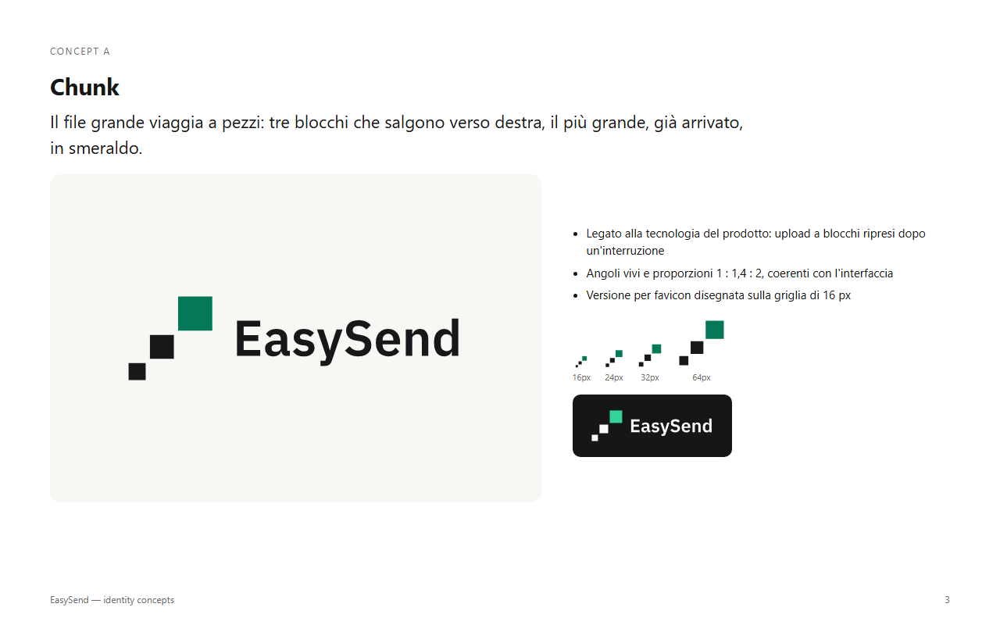
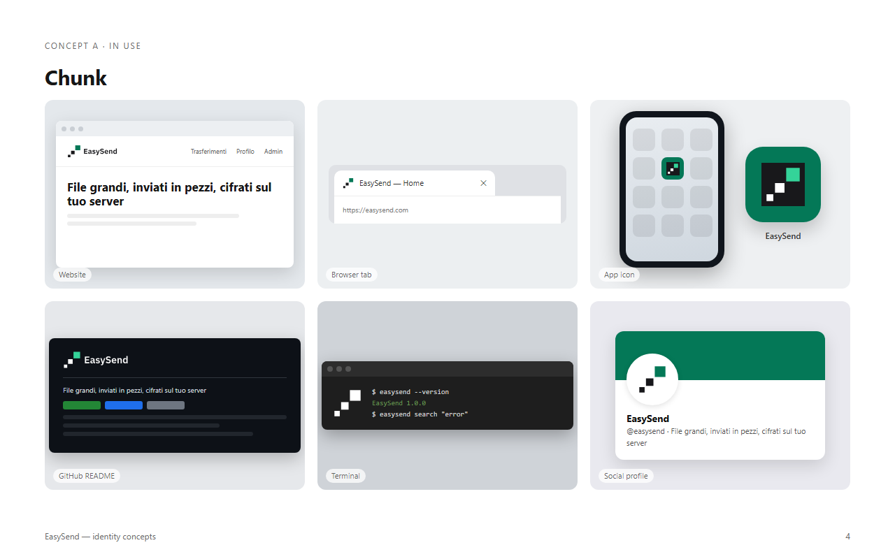

# EasySend — logo e regole d'uso

## Idea

**Chunk.** Il file grande viaggia a pezzi: tre blocchi quadrati salgono verso destra, e il più grande, cioè il file arrivato, è smeraldo. Richiama l'upload a blocchi dell'app, che si riprende dopo un'interruzione. Gli angoli vivi e le proporzioni 1 : 1,4 : 2 sono coerenti con l'interfaccia "Netto e tecnico".

## File

Le icone web dell'app (`favicon.ico`, `favicon.svg`, `apple-touch-icon.png`, icone 192/512 e maskable, `site.webmanifest`) sono in `apps/web/public/` e collegate da `apps/web/index.html`.

| File                                       | Uso                                                                                                |
| ------------------------------------------ | -------------------------------------------------------------------------------------------------- |
| `easysend-tile.svg`                        | **Logo principale** su riquadro scuro: icona app, pagine pubbliche, avatar                         |
| `easysend-tile-small.svg`                  | Versione per 16–32 px, disegnata sulla griglia di 16 px: favicon e icone piccole                   |
| `easysend-tile-mono.svg`                   | Riquadro in un colore, con i blocchi scavati (stampa, timbri)                                      |
| `easysend-symbol.svg`                      | Simbolo libero per il tema chiaro                                                                  |
| `easysend-symbol-dark.svg`                 | Simbolo libero per il tema scuro                                                                   |
| `easysend-symbol-black.svg` / `-white.svg` | Simbolo in un colore                                                                               |
| `easysend-horizontal.svg` / `-dark.svg`    | Simbolo + nome per l'header dell'app e le email                                                    |
| `easysend-horizontal-black.svg`            | Simbolo + nome in un colore                                                                        |
| `easysend-wordmark.svg`                    | Solo il nome                                                                                       |
| `apps/web/public/`                         | `favicon.ico`, `favicon.svg`, `apple-touch-icon.png`, icone 192/512 e maskable, `site.webmanifest` |

Il nome è in IBM Plex Sans SemiBold (licenza SIL Open Font License), convertito in tracciati: non serve il font per mostrare il logo.

## Colori

| Nome                          | HEX       | Uso                                         |
| ----------------------------- | --------- | ------------------------------------------- |
| Inchiostro (zinc-900)         | `#18181B` | Blocchi e nome sul tema chiaro, riquadro    |
| Smeraldo (emerald-700)        | `#047857` | Blocco grande sul tema chiaro               |
| Smeraldo chiaro (emerald-400) | `#34D399` | Blocco grande sul tema scuro e sul riquadro |
| Carta (zinc-50)               | `#FAFAFA` | Blocchi e nome sul tema scuro               |
| Bianco                        | `#FFFFFF` | Blocchi piccoli sul riquadro                |

## Spazio di rispetto e dimensioni minime

- **Spazio libero** intorno al logo: almeno il lato del blocco più piccolo, su tutti i lati.
- **Simbolo e riquadro:** sotto i 32 px si usa `easysend-tile-small.svg`; il minimo è 16 px.
- **Simbolo + nome:** almeno 120 px di larghezza a schermo, 30 mm in stampa.

## Sfondi

- **Tema chiaro e sfondi chiari:** `easysend-symbol.svg` / `easysend-horizontal.svg`.
- **Tema scuro e sfondi scuri:** `easysend-symbol-dark.svg` / `easysend-horizontal-dark.svg`.
- **Foto o sfondi colorati:** usa il riquadro `easysend-tile.svg`, che si porta dietro il suo sfondo.

## Da non fare

- Arrotondare gli angoli dei blocchi o del riquadro.
- Cambiare l'ordine dei blocchi, la loro distanza o la direzione (salgono sempre verso destra).
- Colorare di smeraldo un blocco diverso da quello grande, o usare altri colori.
- Aggiungere ombre, sfumature, contorni o effetti.
- Mettere il simbolo scuro su sfondo scuro o quello chiaro su sfondo chiaro.
- Riscrivere il nome con un altro font, o deformare il logo.

## Note

- Non è stata fatta una ricerca di anteriorità del marchio. Se il nome o il logo vengono usati commercialmente, conviene una verifica nelle banche dati dei marchi.
- Nell'app questo logo è il **predefinito dell'istanza**: l'admin può sostituirlo nella sezione "Aspetto" (SPEC 8).
