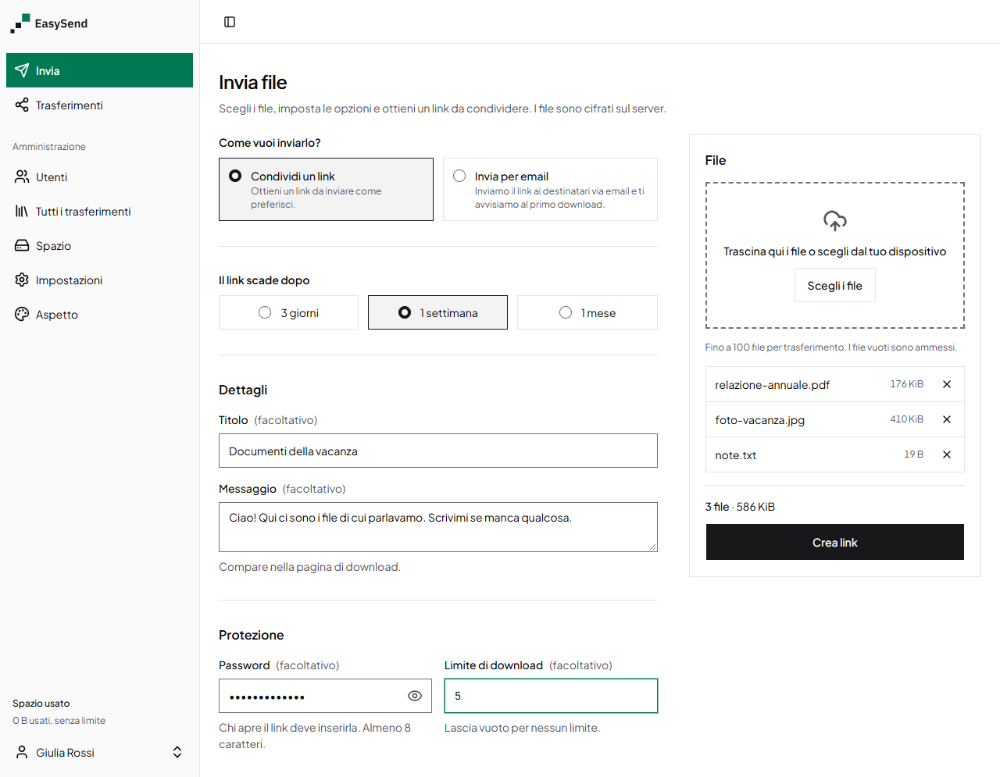
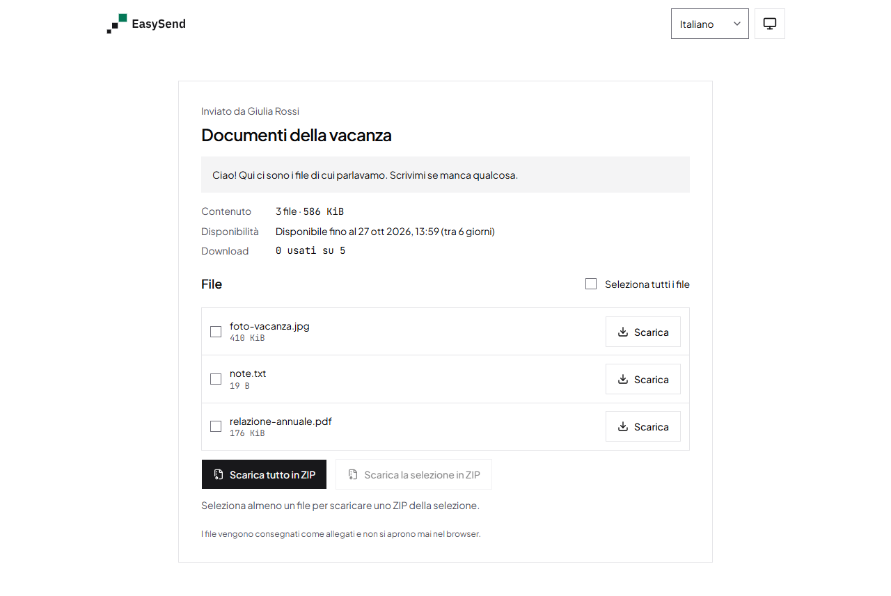
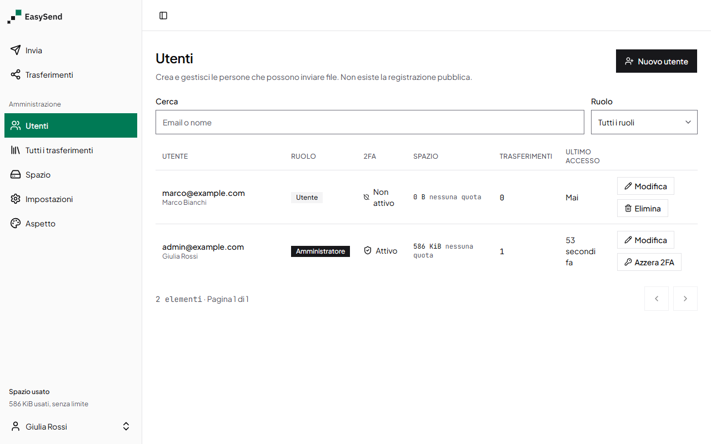

# Introduction

EasySend is a self-hosted web application for sending large files, similar to WeTransfer. You run it on your own server, behind a Cloudflare Tunnel, so no inbound port is opened.



## What it is

- Resumable uploads of very large files with the [tus](https://tus.io) protocol, in chunks of 25 MB (the Cloudflare free plan refuses requests above 100 MB).
- Files are encrypted on the server's disk (AES-256-GCM). Upload, download and zip are streamed, so RAM use does not grow with file size.
- Share by link or by email. Expiry after 3 days, 1 week or 1 month. Optional password and download limit. A transfer can be revoked at any time.
- The sender is notified at the first download.
- Users with roles (admin, user) and per-user quotas. Two-factor authentication (TOTP) is mandatory for admins.
- Italian and English interface, light and dark theme, configurable branding (name, logos, colors, background, footer).
- Setup wizard: admin account, SMTP, Cloudflare tunnel and general settings. No config files to edit by hand.
- No file preview, no built-in antivirus, no public registration (see [Security notes](./security)).

| Download page                                                   | Admin: users                                            |
| --------------------------------------------------------------- | ------------------------------------------------------- |
|  |  |

More screenshots (light and dark) are in [docs/screenshots](https://github.com/ivanerricis/easysend/tree/main/docs/screenshots).

## Architecture

```text
Browser --HTTPS--> Cloudflare --Tunnel--> cloudflared
                                              |
                                              v
                                   web (nginx + React)
                                              |  /api
                                              v
                                       api (Express)
                                         |         |
                                         v         v
                                  SQLite (WAL)   encrypted files
```

| Container     | Content                                                                 | Memory limit |
| ------------- | ----------------------------------------------------------------------- | ------------ |
| `web`         | nginx serving the React app and proxying `/api` to the api              | 128 MB       |
| `api`         | Express, tus upload server, SQLite (WAL) database, encrypted file store | 768 MB       |
| `cloudflared` | Cloudflare Tunnel client (profile `tunnel`)                             | 128 MB       |

Data lives in two Docker volumes: `easysend-data` (database, encrypted files, branding, secrets) and `easysend-shared` (the tunnel token written by the wizard, read by `cloudflared`).
