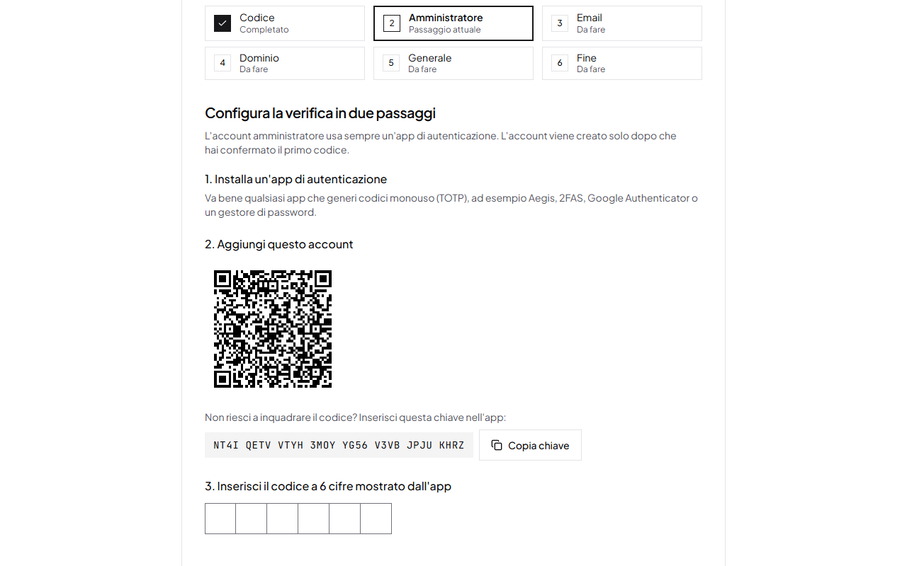

# Primo setup (wizard)

Il container web è pubblicato solo su `127.0.0.1:8080` dell'LXC, quindi prima di configurare Cloudflare lo raggiungi con un tunnel SSH. Dal tuo PC:

```sh
ssh -L 8080:127.0.0.1:8080 easysend@<indirizzo-lxc>
```

Apri http://localhost:8080. Il wizard chiede un codice di setup, che l'api stampa nel log a ogni avvio finché il setup non è completo:

```sh
cd /opt/easysend
docker compose logs api | grep "Setup code"
```

I passi:

1. **Account admin**: email e password, poi autenticazione a due fattori obbligatoria (scansiona il QR) e codici di recupero. Salva i codici: si vedono una sola volta.
2. **SMTP**: server, porta, credenziali e mittente. Il wizard invia un'email di prova e non ti lascia proseguire finché non riesce.
3. **Cloudflare**: il tuo dominio, l'hostname per l'app e un token API ([Token API di Cloudflare](./cloudflare)).
4. **Impostazioni generali**: nome dell'istanza, riserva di spazio su disco, dimensione dei chunk di upload, lingua e tema predefiniti.

Quando il passo Cloudflare termina, il container `cloudflared` parte da solo e l'app risponde su `https://<il tuo hostname>`. Da lì puoi chiudere il tunnel SSH e usare l'indirizzo pubblico.


